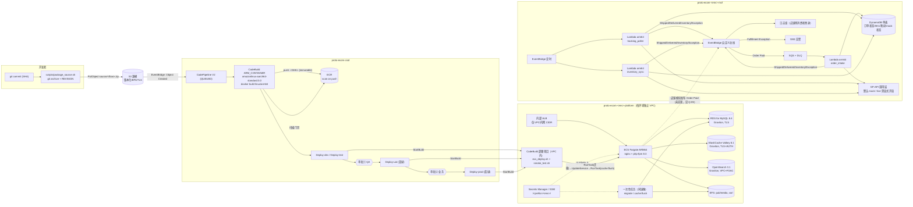

# 架构

> Prototype，不用于生产。场景：某 IoT 厂商的海外独立站（开源 PHP 电商框架 Magento Open Source），先建测试环境与构建发布流程，订单经 Amazon Multi-Channel Fulfillment（MCF）履约。

## 1. 总览

栈：`proto-ecom-cicd`（ECR、源/产物桶、构建项目、流水线、审批主题），`proto-ecom-<env>-platform`（每环境一个 VPC 与全部运行时资源 + 该环境的部署项目），`proto-ecom-<env>-mcf`（履约桥接）。流水线按名字引用各环境部署项目，栈之间没有 CloudFormation 导出，任意环境可单独部署或删除。

## 2. Magento 的 4 个 CI/CD 关键点如何落地

| 关键点 | 落地位置 | 做法 |
|---|---|---|
| 1. 不可变镜像 | `app/magento/Dockerfile`（builder 阶段）、`buildspec/build.yml` | `composer install --no-dev`、`setup:di:compile`、`setup:static-content:deploy` 都在构建阶段执行；为了不连数据库，构建时写入一个不含真实连接的 `env.php` 存根并把 `scopes/themes` 合并进 `config.php`，构建结束删除存根。镜像 tag = commit SHA，ECR 设为不可变 tag；同一 SHA 已存在则复用，不重复构建 |
| 2. 配置分离 | `app/magento/config/config.scopes.php`（进 Git）、`app/magento/docker/build-env.php render`、ECS secrets | `config.php` 类内容进 Git；`env.php` 在容器启动时由环境变量渲染。数据库/OpenSearch/Valkey 凭证与 crypt key 来自 Secrets Manager，`base_url`、后台路径来自 SSM 参数（`/<prefix>/<env>/...`），均通过 ECS `secrets` 注入；`base_url` 写入 `env.php` 的 `system` 段 |
| 3. 数据库迁移单点执行 | `app/magento/docker/migrate.sh`、`scripts/deploy/ecs_deploy.sh` | 部署脚本在更新服务**之前**启动**一个**一次性 ECS 任务：空库时 `setup:install`；否则 `setup:db:status` 判断，需要升级才开维护模式执行 `setup:upgrade --keep-generated`。`var/` 在 EFS 上，维护标志对所有 Web 任务可见。脚本发现已有运行中的 ops 任务就拒绝启动；流水线执行模式为 QUEUED，同一条流水线不会并发执行同一阶段。Web 容器入口从不执行迁移 |
| 4. 零停机与缓存 | `platform_stack.py`、`ecs_deploy.sh` | dev/test：滚动更新（最小健康 100%）+ 断路器自动回滚；uat/prod：ECS 原生蓝绿（绿组验证、切换生产监听规则、bake time 内保留蓝组）。服务稳定后再跑一次性 `cache:flush` 任务（缓存与整页缓存在共享 Valkey 中） |

## 3. 多环境晋级、审批与回滚

- 两条流水线：`develop`（dev，自动）和 `release`（test 自动 + 冒烟 → 审批① → uat 蓝绿 → 审批② → prod 蓝绿）。每条流水线只有一个构建动作，后续所有部署阶段输入同一个构建产物 `imageDetail.json`（同一 SHA 镜像）。环境差异只来自运行时注入的参数。
- 冒烟：部署项目在该环境 VPC 内对内部 ALB 请求 `/health_check.php` 与 `/`。
- 回滚分三层：
  1. **ECS 层**：滚动更新的断路器在新任务起不来或健康检查失败时回到上一个 COMPLETED 部署；蓝绿在绿组不健康时不切流量。部署脚本检查 PRIMARY 部署是否为新修订且 COMPLETED，否则让阶段失败。
  2. **流水线层**：每个 Deploy 阶段配置 `OnFailure: ROLLBACK`，CodePipeline 用该阶段上一次成功执行的产物重新执行该阶段（即上一镜像 tag）。
  3. **手工**：`scripts/rollback.sh <env> [task-def-arn]` 把服务指回指定修订。
- **数据库迁移不可逆**：回滚到旧镜像时，如果新版本已经升级了模块 schema，旧代码的迁移检查会失败，回滚阶段会停在迁移步骤（不会用旧代码去碰新 schema）。这种情况需要人工从迁移前快照恢复（uat/prod 每次部署前自动打快照，dev/test 不打）。

## 4. MCF 履约桥接（独立站 ↔ Amazon MCF）

状态机：`RECEIVED → SUBMITTED → SHIPPED → COMPLETE`，任意步骤可进入 `EXCEPTION`（需人工处理并告警）。

| 环节 | 实现 | SP-API 操作（官方模型字段） |
|---|---|---|
| SKU 映射 | DynamoDB 键 `(SKU#<店铺SKU>, MKT#<市场>) → msku`，状态 `UNVERIFIED/VALID/INVALID`；`scripts`/本地演示从 `sample-data/sku_map.json` 导入 | — |
| 映射校验 + 库存同步 | `inventory_sync` 定时；每市场按 MSKU 分批（模型 `sellerSkus` 上限）调用，处理 `nextToken` 分页；不存在的 MSKU 标 INVALID 并告警；`fulfillableQuantity` 写回映射并发布 `Inventory Updated` 事件 | `getInventorySummaries`（`granularityType=Marketplace`、`granularityId`、`marketplaceIds`、`sellerSkus`、`details`） |
| 下单 | `Order Paid` 事件 → SQS → `order_intake`；`sellerFulfillmentOrderId` 由店铺订单号确定性生成；映射缺失/INVALID 直接 EXCEPTION；429/5xx 由队列重投，第 N 次（默认 3）仍失败标 EXCEPTION、发告警、进入 DLQ；4xx 先查询是否已存在（防重复下单） | `createFulfillmentOrder`（必填：`sellerFulfillmentOrderId`、`displayableOrderId`、`displayableOrderDate`、`displayableOrderComment`、`shippingSpeedCategory`、`destinationAddress`、`items[sellerSku, sellerFulfillmentOrderItemId, quantity]`；可选 `fulfillmentPolicy`=FillOrKill/FillAll/FillAllAvailable、`marketplaceId`、`notificationEmails`） |
| 物流回传 | `tracking_poller` 定时扫描 SUBMITTED/SHIPPED；`fulfillmentShipments[].fulfillmentShipmentPackage[]` 取包裹号，再取跟踪详情；有运单 → SHIPPED 并发布 `Fulfillment Shipped`（含 `customerTrackingLink`）；全部 `DELIVERED` → COMPLETE；订单状态 Cancelled/Unfulfillable/Invalid → EXCEPTION | `getFulfillmentOrder`、`getPackageTrackingDetails`（`packageNumber`） |
| 配送等级 | 店铺 `standard/expedited/priority` → `ShippingSpeedCategory` 的 `Standard/Expedited/Priority` | — |

SP-API 调用层：`MockSpApiClient`（默认，状态存 DynamoDB，可跨 Lambda 冷启动；收件人名 `FAIL_TRANSIENT/FAIL_ALWAYS/INVALID_ADDRESS` 触发故障）与 `LiveSpApiClient`（LWA refresh token 换访问令牌，`x-amz-access-token` 头；**未对真实账户运行**）。live 模式要求 `spapi_mode=live` 且 Secret 不含占位值，否则 Lambda 拒绝启动。

## 5. 设计取舍

- ECS 部署由 VPC 内 CodeBuild 脚本完成，而不是 CodePipeline 的 ECS 动作：换取严格的「迁移 → 切换 → 刷缓存」顺序，代价是部署逻辑在脚本里，需要自己测试（见 `tests/test_config_and_keypoints.py`）。
- CDK 与流水线共同管理任务定义：流水线注册新修订并更新服务；重新 `cdk deploy` 平台栈时需带 `-c imageTag=<当前 SHA>`，否则 CDK 会把任务定义镜像与 desiredCount 改回初始值（desiredCount=0）。
- 单表 DynamoDB + 一个 GSI，换取更少的资源与 IAM 授权；查询按状态与市场。
- 沙箱只部署 dev；四环境差异用参数表达并由 CDK assertions 覆盖。

## 6. 局限

- Magento 店铺侧模块（发布 `Order Paid`、消费发货/库存事件、发货邮件）未实现，只定义了事件契约（Q-05）。
- 未做性能测试、容量规划与成本评估；`config/*.json` 中的实例规格是占位值。
- `migrate.sh` 中 `setup:install` 的 `--db-ssl-*`、`--opensearch-*` 参数与 Valkey `tls://` 写法未在本次部署中验证（以 `VERIFICATION.md` 为准）。
- 媒体与 `var/` 放 EFS；未做 CDN、跨区域与对象存储媒体方案（Q-09）。
- Cron（`bin/magento cron:run`）、消息队列消费者未部署；生产需要单独的定时任务/服务。
- 后台管理入口、TLS 证书、WAF 未配置（ALB 仅内部 HTTP）。

## 7. 事实核对（核实日期 2026-10-20）

| # | 说法 | 官方来源 |
|---|---|---|
| F-01 | Magento Open Source 仓库许可为 OSL-3.0（`LICENSE.txt`），另含 `LICENSE_AFL.txt` | https://github.com/magento/magento2/blob/2.4-develop/LICENSE.txt |
| F-02 | 2.4.8 最新补丁（on-premises）：PHP 8.4/8.3、MySQL 8.4、MariaDB 11.4/11.8、OpenSearch 3、Valkey 8.1、Composer 2.10；2.4.9：PHP 8.5、Valkey 9；2.4.7 最新补丁不再支持 MySQL；页面未提及 CPU 架构 | https://experienceleague.adobe.com/en/docs/commerce-operations/installation-guide/system-requirements |
| F-03 | PHP 8.2 及以上在 Graviton 上测试表现良好，在 AL2023 / Ubuntu 22.04 上开箱可用 | https://github.com/aws/aws-graviton-getting-started/blob/main/php.md |
| F-04 | Graviton 可用于 RDS、Aurora、ElastiCache、OpenSearch Service、Fargate、Lambda、CodeBuild；ECR 支持多架构镜像 | https://github.com/aws/aws-graviton-getting-started/blob/main/managed_services.md |
| F-05 | Fargate 上的 Linux 容器可用 ARM64 架构 | https://docs.aws.amazon.com/AmazonECS/latest/developerguide/fargate-tasks-services.html |
| F-06 | 所有受支持的 Lambda 运行时都支持 x86_64 与 arm64；`python3.14` 为受支持运行时（AL2023） | https://docs.aws.amazon.com/lambda/latest/dg/lambda-runtimes.html |
| F-07 | CodeBuild 提供 `aws/codebuild/amazonlinux-aarch64-standard:3.0`（AL2023）与 `:2.0`（AL2） | https://docs.aws.amazon.com/codebuild/latest/userguide/ec2-compute-images.html |
| F-08 | CodeBuild 的 ARM 环境类型包括 `ARM_CONTAINER`、`ARM_LAMBDA_CONTAINER`；VPC 内构建使用 Docker 需开启特权模式 | https://docs.aws.amazon.com/codebuild/latest/userguide/build-env-ref-compute-types.html |
| F-09 | CodePipeline 可把阶段回滚到该阶段上一次成功的执行（可配置失败时自动回滚），使用目标执行的产物与变量；源阶段不能回滚 | https://docs.aws.amazon.com/codepipeline/latest/userguide/stage-rollback.html |
| F-10 | 手工审批未在七天内处理即视为失败；SNS 通知可选 | https://docs.aws.amazon.com/codepipeline/latest/userguide/approvals.html |
| F-11 | ECS 原生蓝绿：bake time、生命周期钩子（Lambda 或暂停）、对带负载均衡器的服务自动切换流量 | https://docs.aws.amazon.com/AmazonECS/latest/developerguide/deployment-type-blue-green.html |
| F-12 | 部署断路器可自动回滚到 COMPLETED 部署，仅适用于滚动更新（`ECS`）部署控制器 | https://docs.aws.amazon.com/AmazonECS/latest/developerguide/deployment-circuit-breaker.html |
| F-13 | OpenSearch Service 支持 OpenSearch 3.5、3.3、3.1、2.19 等版本 | https://docs.aws.amazon.com/opensearch-service/latest/developerguide/what-is.html |
| F-14 | RDS for MySQL 支持 8.4（标准支持）；8.0 仅在 Extended Support 下可用 | https://docs.aws.amazon.com/AmazonRDS/latest/UserGuide/MySQL.Concepts.VersionMgmt.html |
| F-15 | ElastiCache 提供 Valkey 引擎版本（含 8.1）；RDS for MySQL 8.4 可选 Graviton 实例族；OpenSearch 3.x 可选 Graviton 实例族（AWS API `describe-cache-engine-versions`、`describe-orderable-db-instance-options`、`list-instance-type-details` 于 us-east-1 查询） | https://docs.aws.amazon.com/AmazonElastiCache/latest/dg/CacheNodes.SupportedTypes.html ，https://docs.aws.amazon.com/AmazonRDS/latest/UserGuide/Concepts.DBInstanceClass.html |
| F-16 | Fulfillment Outbound 2020-07-01：`createFulfillmentOrder`（POST `/fba/outbound/2020-07-01/fulfillmentOrders`）、`getFulfillmentOrder`、`getPackageTrackingDetails`（GET `/tracking?packageNumber=`）等；必填字段、`ShippingSpeedCategory`（Standard/Expedited/Priority/ScheduledDelivery）、`FulfillmentPolicy`（FillOrKill/FillAll/FillAllAvailable）、`sellerFulfillmentOrderId` 最长 40；`fulfillmentShipmentStatus`、`CurrentStatus` 枚举 | https://github.com/amzn/selling-partner-api-models/blob/main/models/fulfillment-outbound-api-model/fulfillmentOutbound_2020-07-01.json |
| F-17 | FBA Inventory v1：`getInventorySummaries`（GET `/fba/inventory/v1/summaries`），`granularityType=Marketplace`、`marketplaceIds` 最多 1 个、`sellerSkus` 最多 50 个、`nextToken` 分页、`inventoryDetails.fulfillableQuantity` | https://github.com/amzn/selling-partner-api-models/blob/main/models/fba-inventory-api-model/fbaInventory.json |
| F-18 | LWA 令牌端点 `https://api.amazon.com/auth/o2/token`（`grant_type=refresh_token`、`client_id`、`client_secret`），访问令牌放在 `x-amz-access-token` 头 | https://developer-docs.amazon.com/sp-api/docs/connecting-to-the-selling-partner-api |
| F-19 | SP-API 端点：NA `sellingpartnerapi-na.amazon.com`、EU `sellingpartnerapi-eu.amazon.com`、FE `sellingpartnerapi-fe.amazon.com`；美国站 marketplaceId `ATVPDKIKX0DER` | https://developer-docs.amazon.com/sp-api/docs/sp-api-endpoints ，https://developer-docs.amazon.com/sp-api/docs/marketplace-ids |
| F-20 | Amazon 官方 SP-API 示例已有 MCF（fulfillment-outbound）用例：CDK + Step Functions + Lambda | https://github.com/amzn/selling-partner-api-samples/tree/main/use-cases/fulfillment-outbound |
| F-21 | ECR 基础扫描支持 scan on push，每张镜像 24 小时内可扫描一次，结果可查询并发 EventBridge 事件 | https://docs.aws.amazon.com/AmazonECR/latest/userguide/image-scanning-basic.html |
| F-22 | RDS 全局证书包 `https://truststore.pki.rds.amazonaws.com/global/global-bundle.pem` | https://docs.aws.amazon.com/AmazonRDS/latest/UserGuide/UsingWithRDS.SSL.html |
| F-23 | Docker 官方 `php`、`composer` 镜像提供 arm64v8；ECR Public 上 `docker/library/php:8.3-fpm-bookworm` 的清单含 arm64（registry API 查询） | https://hub.docker.com/_/php ，https://gallery.ecr.aws/docker/library/php |
| F-24 | Amazon MCF 集成目录未列出 Adobe Commerce/Magento 应用 | https://supplychain.amazon.com/integrations |

已核实不了、因而从仓库中删除或未写入的说法：SP-API 是否仍要求 SigV4 签名（改为 OPEN-QUESTIONS Q-13）；Aurora MySQL 是否提供 MySQL 8.4 兼容版本（改用 RDS for MySQL，D-06）；部署断路器能否与 ECS 原生蓝绿同时使用（未使用）。
