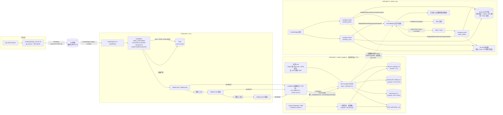

# 架构

> Prototype，不用于生产。场景：某 IoT 厂商的海外独立站（开源 PHP 电商框架 Magento Open Source），先建测试环境与构建发布流程，订单经 Amazon Multi-Channel Fulfillment（MCF）履约。mermaid 图是架构的事实来源。本文描述 `v0.1.0` 标签对应的提交（验证所用提交哈希见 `VERIFICATION.md`）。

信任边界：独立站 → EventBridge 总线；桥接 → SP-API（外部 HTTPS）；源码/依赖 → CodeBuild → ECR；CodePipeline → 各环境 VPC 内部署项目 → ECS；运维人员 → 运维脚本（`promote_image.sh`、`mcf_redrive.py`）。威胁与对策见 `THREAT_MODEL.md`。部署拓扑：单账号单区域，每个环境一个 VPC（公有子网只放 NAT，应用子网放 ALB/任务/部署项目，隔离子网放数据层）。

## 1. 总览

栈：`<PROJECT>-cicd`（ECR、源/产物桶、构建项目、流水线、审批主题），`<PROJECT>-<ENV>-platform`（每环境一个 VPC 与全部运行时资源 + 该环境的部署项目），`<PROJECT>-<ENV>-mcf`（履约桥接）。`<PROJECT>` 与 SSM 前缀来自配置文件（默认 `proto-ecom`、`/proto-ecom`），脚本从配置或部署元数据读取，不写死。流水线按名字引用各环境部署项目，栈之间没有 CloudFormation 导出，任意环境可单独部署或删除。

## 2. Magento 的 4 个 CI/CD 关键点如何落地

| 关键点 | 落地位置 | 做法 |
|---|---|---|
| 1. 不可变镜像 | `app/magento/Dockerfile`（source/builder 阶段）、`buildspec/build.yml` | `composer install --no-dev`、`setup:di:compile`、`setup:static-content:deploy` 都在构建阶段执行；为了不连数据库，构建时写入不含真实连接的 `env.php` 存根，构建结束删除。镜像 tag = commit SHA，ECR 不可变 tag；同一 SHA 已存在则复用 |
| 2. 配置分离 | `app/magento/config/config.php`（进 Git）、`app/magento/docker/build-env.php render`、ECS secrets | `app/etc/config.php`（模块、scopes、themes、i18n）提交到 Git，构建直接使用并校验与代码中的模块一致（不一致则构建失败，用 Dockerfile 的 `config-export` 目标或 `scripts/export_magento_config.sh` 重新生成）。`env.php` 在容器启动时由环境变量渲染：数据库/OpenSearch/Valkey 凭证与 crypt key 来自 Secrets Manager，`base_url`、后台路径来自 SSM 参数（`<SSM_PREFIX>/<ENV>/...`），均通过 ECS `secrets` 注入 |
| 3. 数据库迁移单点执行 | `app/magento/docker/migrate.sh`、`scripts/deploy/ecs_deploy.sh` | 部署脚本在更新服务**之前**启动**一个**一次性 ECS 任务；脚本拒绝在已有 ops 任务运行时再启动；迁移脚本再持有 MySQL `GET_LOCK`（会话级，任务退出或连接断开即释放），第二个迁移立即失败。空库 `setup:install`；否则 `setup:db:status` 判断，需要升级才开维护模式执行 `setup:upgrade --keep-generated`。任务带 init 进程，SIGTERM 能触发脚本的清理陷阱。Web 容器入口从不执行迁移 |
| 4. 零停机与缓存 | `platform_stack.py`、`ecs_deploy.sh`、`cache-flush.sh` | dev/test：滚动更新（最小健康 100%）+ 断路器自动回滚；uat/prod：ECS 原生蓝绿（bake time 内保留蓝组）。服务稳定后再跑一次性 `cache:flush` 任务；本次部署开过维护模式的，`cache:flush` 之后才关闭（见 §3） |

## 3. 多环境晋级、审批与回滚

- 两条流水线：`develop`（dev，自动）和 `release`（test 自动 + 冒烟 → 审批① → uat 蓝绿 → 审批② → prod 蓝绿）。每条流水线只有一个构建动作，后续所有部署阶段输入同一个构建产物 `imageDetail.json`（同一 SHA 镜像）。环境差异只来自运行时注入的参数。
- 镜像门禁：构建后扫描门禁阻断的镜像被隔离（删除可晋级的 tag，摘要保留为 `quarantine-<TAG>`）；每次部署开始时用同一门禁参数复查 tag 与扫描结果，复查不过就不做任何变更（也覆盖 `scripts/promote_image.sh`）。`promote_image.sh` 对有审批的环境默认拒绝，需 `--break-glass "<理由>"`。
- 冒烟：部署项目在该环境 VPC 内访问内部 ALB 的 `/health_check.php` 与 `/`；https 环境用证书主机名并校验证书（`curl --connect-to` 指向 ALB）。
- 有 schema 变更的发布顺序：迁移任务开维护模式并 `setup:upgrade` → 更新服务（维护期间健康检查 `/health_check.php` 不受维护模式影响，新任务照常通过）→ PRIMARY 部署为新修订且 COMPLETED → `cache:flush` → 关闭维护模式。这样旧代码不会在切换期间服务已升级的 schema。
- 迁移开始后的任何失败（迁移失败、超时被停止、滚动/蓝绿回滚、cache:flush 失败），部署脚本的 EXIT 陷阱按环境参数 `maintenance_on_failure` 跑一次维护任务：`disable`（dev/test 默认）关闭维护模式，恢复访问，代价是可能出现旧代码 + 新 schema；`keep`（uat/prod 默认）保持维护模式，由人从迁移前快照恢复或完成发布。迁移在 `setup:upgrade` 开始前失败的，迁移脚本自己关闭维护模式。
- 回滚分三层：
  1. **ECS 层**：滚动更新的断路器在新任务起不来或健康检查失败时回到上一个 COMPLETED 部署；蓝绿在绿组不健康时不切流量。部署脚本检查 PRIMARY 部署是否为新修订且 COMPLETED，否则让阶段失败（随后按上一条处理维护模式）。
  2. **流水线层**：每个 Deploy 阶段配置 `OnFailure: ROLLBACK`，CodePipeline 用该阶段上一次成功执行的产物重新执行该阶段（即上一镜像 tag，同样先迁移检查再切换）。
  3. **手工**：`scripts/rollback.sh <ENV> [task-def-arn]` 只把服务指回指定修订，不碰数据库。
- **数据库迁移不可逆**：回滚到旧镜像不会撤销 schema。旧镜像的迁移检查遇到它不认识的新表/新模块时的实际行为见 `VERIFICATION.md`（沙箱实测）；schema 不兼容时应从迁移前快照恢复（uat/prod 每次部署前自动快照并保留最近 `predeploy_snapshots_keep` 个，dev/test 不打）。

## 4. MCF 履约桥接（独立站 ↔ Amazon MCF）

状态机：`RECEIVED → SUBMITTED → SHIPPED → COMPLETE`；`CANCELLED`（店铺取消或 MCF 侧取消）；任意步骤可进入 `EXCEPTION`（需人工处理并告警）。

与店铺订单状态的对应（店铺侧映射由 Magento 模块实现，未包含在本仓库）：

| 店铺订单状态 | 桥接状态 / 事件 |
|---|---|
| 待支付 | 不进入桥接（只有 `Order Paid` 才触发）；支付前取消也可先发 `Order Cancelled`，桥接记 CANCELLED，迟到的 `Order Paid` 被忽略 |
| 已支付 | `Order Paid` → RECEIVED |
| 履约中 | SUBMITTED（事件 `Fulfillment Order Submitted`） |
| 已发货 | SHIPPED（`Fulfillment Shipped`，含承运商、运单号、跟踪链接） |
| 已完成 | COMPLETE（`Fulfillment Delivered`；首轮轮询就已签收时先补发 `Fulfillment Shipped`） |
| 已取消 | CANCELLED（`Fulfillment Cancelled`，`source=storefront` 或 `mcf`） |
| （异常，人工处理） | EXCEPTION（`Fulfillment Exception` → SNS 告警） |

| 环节 | 实现 | SP-API 操作（官方模型字段） |
|---|---|---|
| SKU 映射 | DynamoDB 键 `(SKU#<店铺SKU>, MKT#<市场>) → msku`，状态 `UNVERIFIED/VALID/INVALID`；从 `sample-data/sku_map.json` 导入 | — |
| 映射校验 + 库存同步 | `inventory_sync` 定时；每市场用该市场所属区域的客户端，按 MSKU 分批（模型 `sellerSkus` 上限）调用，处理 `nextToken` 分页；不存在的 MSKU 标 INVALID 并告警；`fulfillableQuantity` 写回映射并发布 `Inventory Updated`（绝对数量，下一次运行覆盖） | `getInventorySummaries` |
| 下单 | `Order Paid` → SQS → `order_intake`（默认 batch 1，超时与可见性超时按配置推导，F-31）；`sellerFulfillmentOrderId` 由店铺订单号确定性生成；映射缺失/INVALID 直接 EXCEPTION；429/5xx 由队列重投；4xx 先 `getFulfillmentOrder` 确认是否已存在（确认丢失的情况）；第 N 次（默认 3）仍失败前再确认一次，确认不了则 EXCEPTION + `mcf_check`，轮询器继续确认；消息进入 DLQ | `createFulfillmentOrder`、`getFulfillmentOrder` |
| 重驱 | `scripts/mcf_redrive.py` 把 DLQ 消息加 `retry=true` 送回队列；只有带该标志的消息才把 EXCEPTION 订单重置为 RECEIVED | — |
| 取消 | `Order Cancelled` → 同一队列；发货前调用取消并置 CANCELLED；已发货/已完成拒绝并发异常事件 | `cancelFulfillmentOrder`（F-29） |
| 物流回传 | `tracking_poller` 定时：先补发 outbox 中的事件，再确认 `mcf_check` 订单、清扫卡在 RECEIVED 的订单（超过所有重投时间 → EXCEPTION），最后逐单跟踪 SUBMITTED/SHIPPED；每张订单独立处理，单张失败只计数 | `getFulfillmentOrder`、`getPackageTrackingDetails` |
| 配送等级 | 店铺 `standard/expedited/priority` → `Standard/Expedited/Priority` | — |

可靠性：状态变化与它产生的事件在同一次条件写入里落库（乐观锁 `version`，事务性 outbox），EventBridge 接受后才从 outbox 移除；发布失败时状态照常推进、事件留在 outbox，由轮询器或下一次投递补发。投递语义是至少一次，事件带 `eventId`（`<订单号>:<序号>`）供消费者去重。

SP-API 调用层：`MockSpApiClient`（默认，状态存 DynamoDB，可跨 Lambda 冷启动；收件人名 `FAIL_TRANSIENT`、`FAIL_FIRST_<N>`、`FAIL_ALWAYS`、`INVALID_ADDRESS`、`LOST_ACK` 触发故障）与 `LiveSpApiClient`（LWA refresh token 换访问令牌，`x-amz-access-token` 头；**未对真实账户运行**）。每个 SP-API 区域一个客户端；live 模式要求 `spapi_mode=live` 且 Secret 中每个区域的 refresh token 都不是占位值，否则 Lambda 拒绝启动。

## 5. 设计取舍

- ECS 部署由 VPC 内 CodeBuild 脚本完成，而不是 CodePipeline 的 ECS 动作：换取严格的「迁移 → 切换 → 刷缓存/关维护」顺序，代价是部署逻辑在脚本里，需要自己测试（`tests/test_config_and_keypoints.py`）。ECS 原生蓝绿的生命周期钩子（A13）是 Lambda，适合切流前验证，不适合运行一次性迁移任务。
- CDK 与流水线共同管理任务定义：流水线注册新修订并更新服务；重新 `cdk deploy` 平台栈时需按环境带 `-c imageTags=<ENV>=<当前 tag>`（当前 tag 在 SSM `<SSM_PREFIX>/<ENV>/current_image_tag`），否则该环境回到初始状态（desiredCount=0）。
- TLS 在 ALB 终止，ALB → 任务为 VPC 内 HTTP（SECURITY-NOTES「传输加密例外」）。
- 单表 DynamoDB + 两个 GSI（状态/映射；稀疏 outbox 索引），换取更少的资源与 IAM 授权。
- 沙箱只部署 dev；四环境差异用参数表达并由 CDK assertions 覆盖。

## 6. 局限

- Magento 店铺侧模块（发布 `Order Paid`/`Order Cancelled`、消费发货/库存/取消事件、缺货上下架、发货邮件）未实现，只定义了事件契约（Q-05）；履约闭环在店铺一侧只到事件为止。
- 未做性能测试、容量规划与成本评估；交付配置的实例类留空待填。
- https 环境（uat/prod）未在 AWS 上部署过，只由 CDK assertions 覆盖；指向内部 ALB 的私有 DNS 记录不在栈内创建（Q-16）。
- 账号级注册表若使用增强扫描，首次扫描可能长时间不出结果；沙箱中能否拿到结果见 `VERIFICATION.md`。
- 媒体与 `var/` 放 EFS；未做 CDN、跨区域与对象存储媒体方案（Q-09）。
- Cron（`bin/magento cron:run`）、消息队列消费者未部署；生产需要单独的定时任务/服务。
- 后台管理入口、WAF 未配置。

## 7. 事实核对（核实日期 2026-10-20，F-25 起为 2026-10-21）

| # | 说法 | 官方来源 |
|---|---|---|
| F-01 | Magento Open Source 仓库许可为 OSL-3.0（`LICENSE.txt`），另含 `LICENSE_AFL.txt` | https://github.com/magento/magento2/blob/2.4-develop/LICENSE.txt |
| F-02 | 2.4.8 最新补丁（on-premises）：PHP 8.4/8.3、MySQL 8.4、MariaDB 11.4/11.8、OpenSearch 3、Valkey 8.1、Composer 2.10；2.4.9：PHP 8.5、Valkey 9；2.4.7 最新补丁不再支持 MySQL；页面未提及 CPU 架构 | https://experienceleague.adobe.com/en/docs/commerce-operations/installation-guide/system-requirements |
| F-03 | PHP 8.2 及以上在 Graviton 上测试表现良好，在 AL2023 / Ubuntu 22.04 上开箱可用 | https://github.com/aws/aws-graviton-getting-started/blob/main/php.md |
| F-04 | Graviton 可用于 RDS、Aurora、ElastiCache、OpenSearch Service、Fargate、Lambda、CodeBuild；ECR 支持多架构镜像 | https://github.com/aws/aws-graviton-getting-started/blob/main/managed_services.md |
| F-05 | Fargate 上的 Linux 容器可用 ARM64 架构 | https://docs.aws.amazon.com/AmazonECS/latest/developerguide/fargate-tasks-services.html |
| F-06 | 所有受支持的 Lambda 运行时都支持 x86_64 与 arm64；`python3.14` 为受支持运行时（AL2023） | https://docs.aws.amazon.com/lambda/latest/dg/lambda-runtimes.html |
| F-07 | CodeBuild 提供 `aws/codebuild/amazonlinux-aarch64-standard:3.0`（AL2023）与 `:2.0`（AL2） | https://docs.aws.amazon.com/codebuild/latest/userguide/ec2-compute-images.html |
| F-08 | CodeBuild 的 ARM 环境类型包括 `ARM_CONTAINER`、`ARM_LAMBDA_CONTAINER`；VPC 内构建使用 Docker 需开启特权模式 | https://docs.aws.amazon.com/codebuild/latest/userguide/build-env-ref-compute-types.html |
| F-09 | CodePipeline 可把阶段回滚到该阶段上一次成功的执行（可配置失败时自动回滚），使用目标执行的产物与变量；源阶段不能回滚 | https://docs.aws.amazon.com/codepipeline/latest/userguide/stage-rollback.html |
| F-10 | 手工审批未在七天内处理即视为失败；SNS 通知可选 | https://docs.aws.amazon.com/codepipeline/latest/userguide/approvals.html |
| F-11 | ECS 原生蓝绿：bake time、生命周期钩子（Lambda 或暂停）、对带负载均衡器的服务自动切换流量 | https://docs.aws.amazon.com/AmazonECS/latest/developerguide/deployment-type-blue-green.html |
| F-12 | 部署断路器可自动回滚到 COMPLETED 部署，仅适用于滚动更新（`ECS`）部署控制器 | https://docs.aws.amazon.com/AmazonECS/latest/developerguide/deployment-circuit-breaker.html |
| F-13 | OpenSearch Service 支持 OpenSearch 3.5、3.3、3.1、2.19 等版本 | https://docs.aws.amazon.com/opensearch-service/latest/developerguide/what-is.html |
| F-14 | RDS for MySQL 支持 8.4（标准支持）；8.0 仅在 Extended Support 下可用 | https://docs.aws.amazon.com/AmazonRDS/latest/UserGuide/MySQL.Concepts.VersionMgmt.html |
| F-15 | ElastiCache 提供 Valkey 引擎版本（含 8.1）；RDS for MySQL 8.4、ElastiCache for Valkey、OpenSearch 3.x 在部署区域均可选 Graviton 实例族（用 AWS API `describe-orderable-db-instance-options`、`describe-cache-engine-versions`、`list-instance-type-details` 于 us-east-1 查询；具体型号以官方页面为准，仓库只在 `config/sandbox.json` 放沙箱可部署值） | https://docs.aws.amazon.com/AmazonElastiCache/latest/dg/CacheNodes.SupportedTypes.html ，https://docs.aws.amazon.com/AmazonRDS/latest/UserGuide/Concepts.DBInstanceClass.html ，https://docs.aws.amazon.com/opensearch-service/latest/developerguide/supported-instance-types.html |
| F-16 | Fulfillment Outbound 2020-07-01：`createFulfillmentOrder`（POST `/fba/outbound/2020-07-01/fulfillmentOrders`）、`getFulfillmentOrder`、`getPackageTrackingDetails`（GET `/tracking?packageNumber=`）等；必填字段、`ShippingSpeedCategory`（Standard/Expedited/Priority/ScheduledDelivery）、`FulfillmentPolicy`（FillOrKill/FillAll/FillAllAvailable）、`sellerFulfillmentOrderId` 最长 40；`fulfillmentShipmentStatus`、`CurrentStatus` 枚举 | https://github.com/amzn/selling-partner-api-models/blob/main/models/fulfillment-outbound-api-model/fulfillmentOutbound_2020-07-01.json |
| F-17 | FBA Inventory v1：`getInventorySummaries`（GET `/fba/inventory/v1/summaries`），`granularityType=Marketplace`、`marketplaceIds` 最多 1 个、`sellerSkus` 最多 50 个、`nextToken` 分页、`inventoryDetails.fulfillableQuantity` | https://github.com/amzn/selling-partner-api-models/blob/main/models/fba-inventory-api-model/fbaInventory.json |
| F-18 | LWA 令牌端点 `https://api.amazon.com/auth/o2/token`（`grant_type=refresh_token`、`client_id`、`client_secret`），访问令牌放在 `x-amz-access-token` 头 | https://developer-docs.amazon.com/sp-api/docs/connecting-to-the-selling-partner-api |
| F-19 | SP-API 端点：NA `sellingpartnerapi-na.amazon.com`、EU `sellingpartnerapi-eu.amazon.com`、FE `sellingpartnerapi-fe.amazon.com`；美国站 marketplaceId `ATVPDKIKX0DER` | https://developer-docs.amazon.com/sp-api/docs/sp-api-endpoints ，https://developer-docs.amazon.com/sp-api/docs/marketplace-ids |
| F-20 | Amazon 官方 SP-API 示例已有 MCF（fulfillment-outbound）用例：CDK + Step Functions + Lambda | https://github.com/amzn/selling-partner-api-samples/tree/main/use-cases/fulfillment-outbound |
| F-21 | ECR 基础扫描支持 scan on push，每张镜像 24 小时内可扫描一次，结果可查询并发 EventBridge 事件 | https://docs.aws.amazon.com/AmazonECR/latest/userguide/image-scanning-basic.html |
| F-22 | RDS 全局证书包 `https://truststore.pki.rds.amazonaws.com/global/global-bundle.pem` | https://docs.aws.amazon.com/AmazonRDS/latest/UserGuide/UsingWithRDS.SSL.html |
| F-23 | Docker 官方 `php`、`composer` 镜像提供 arm64v8；ECR Public 上 `docker/library/php:8.3-fpm-bookworm` 的清单含 arm64（registry API 查询） | https://hub.docker.com/_/php ，https://gallery.ecr.aws/docker/library/php |
| F-24 | Amazon MCF 集成目录未列出 Adobe Commerce/Magento 应用 | https://supplychain.amazon.com/integrations |
| F-25 | 任务定义 `initProcessEnabled`：在容器内运行转发信号、回收进程的 init 进程（对应 `docker run --init`）；`stopTimeout` 默认 30 秒、Fargate 上最大 120 秒 | https://docs.aws.amazon.com/AmazonECS/latest/developerguide/task_definition_parameters.html |
| F-26 | StopTask 先发停止信号（默认 SIGTERM），超时（默认 30 秒）后发 SIGKILL | https://docs.aws.amazon.com/AmazonECS/latest/APIReference/API_StopTask.html |
| F-27 | ACM 证书是区域资源，要在使用它的负载均衡器所在区域申请或导入；ALB HTTPS 监听推荐使用 ACM 证书 | https://docs.aws.amazon.com/acm/latest/userguide/acm-overview.html ，https://docs.aws.amazon.com/elasticloadbalancing/latest/application/https-listener-certificates.html |
| F-28 | ELB 推荐的安全策略为 `ELBSecurityPolicy-TLS13-1-2-Res-PQ-2025-09`；通过 CLI/CloudFormation/CDK 创建监听器时若不指定，默认是 `ELBSecurityPolicy-2016-08` | https://docs.aws.amazon.com/elasticloadbalancing/latest/application/describe-ssl-policies.html |
| F-29 | Fulfillment Outbound 2020-07-01：`cancelFulfillmentOrder` 为 `PUT /fba/outbound/2020-07-01/fulfillmentOrders/{sellerFulfillmentOrderId}/cancel`；`FulfillmentOrderStatus` 枚举含 New、Received、Planning、Processing、Cancelled、Complete、CompletePartialled、Unfulfillable、Invalid | https://github.com/amzn/selling-partner-api-models/blob/main/models/fulfillment-outbound-api-model/fulfillmentOutbound_2020-07-01.json |
| F-30 | SP-API EU 端点覆盖德国（`A1PA6795UKMFR9`），FE 端点覆盖日本（`A1VC38T7YXB528`） | https://developer-docs.amazon.com/sp-api/docs/sp-api-endpoints ，https://developer-docs.amazon.com/sp-api/docs/marketplace-ids |
| F-31 | SQS 事件源：队列可见性超时至少设为函数超时的 6 倍；函数超时不得超过可见性超时 | https://docs.aws.amazon.com/lambda/latest/dg/services-sqs-configure.html |

已核实不了、因而从仓库中删除或未写入的说法：「SP-API 已正式取消 SigV4」这类公告式说法（只依据 F-18 页面的调用步骤，见 OPEN-QUESTIONS 已关闭的 Q-13）；Aurora MySQL 是否提供 MySQL 8.4 兼容版本（改用 RDS for MySQL，D-06）；部署断路器能否与 ECS 原生蓝绿同时使用（未使用）。
